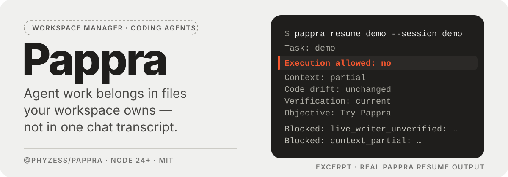
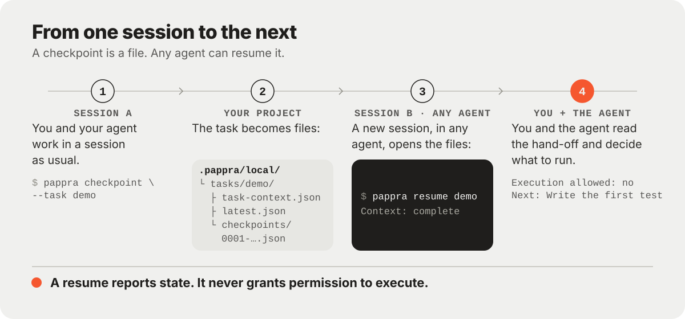

<p align="center">
  <strong>English</strong> · <a href="README.zh-CN.md">简体中文</a>
</p>

<p align="center">
  
</p>

**Your coding agent's session ends; the task does not. Pappra keeps the goal, the decisions and
the next step in your project as plain files, so the next session, in any agent, can pick the
work back up.**

## What is Pappra?

You already give your coding agent standing instructions in `CLAUDE.md` or `AGENTS.md`: how to
build, how to test, what style to follow. Those files say how to work, not where the work stands.
That lives in the conversation, so when a session gets too long, you switch tools, or you come
back tomorrow, the new session starts from nothing.

Pappra keeps the state of the task in progress — the objective, the decisions, what was tried,
what is blocked, what to do next — as files in your project folder. Any agent you choose can read
them, and none of it is lost with the chat.

- **Pick up a task in any agent.** A checkpoint saved by one session can be read by the next one,
  whichever agent it runs in.
- **Project knowledge.** Register the documents an agent should read, so the next session finds
  them instead of asking you to paste them again.
- **Code navigation.** Look up code without handing over the whole repository. Text and structure
  search work with no extra tools installed.
- **Coordinate several agents.** Split one task between agents with a visible, recorded workflow, and
  hand a running coordinator role to a fresh Claude Code or Codex session without losing the thread.
- **Connect your agents.** Claude Code, Codex and Pi can read checkpoints through Pappra's skill and
  hook, and the skill saves one when you ask.

Use only the parts you need.

## See it

A checkpoint is a saved note about one task: what it is, how you know it is done, where it stopped. A
new session runs `pappra resume demo` and gets the state of the task, not the old transcript:

```text
Task: demo
Checkpoint: checkpoints/0001-d523d72a-4553-4579-883d-93409c9df53e.json@1
Execution allowed: no
Context: complete
Code drift: unchanged
Verification: current
Objective: Try Pappra
Blocked: live_writer_unverified: P07 cannot establish live writer/stop ownership from a stored session string; execution remains blocked.
Blocked: unknown_writer: Checkpoint author session is unknown; execution is blocked.
Next: Write the first test
```

The new session gets the objective, the reasons it cannot start on its own, and the next step, so it
can continue without the old chat. `Execution allowed: no` is intentional: a resume hands over
context, never permission; you and the agent decide what runs. The command exits `0`, and may print
read-only diagnostics on stderr.

## Quick start

You need [Node.js](https://nodejs.org/) 24 or later and Git.

**1. Set Pappra up in a practice folder.** Run it with no arguments in an empty folder. On a
terminal that is the whole setup: it asks for a workspace name, which repositories to include and
which documents to register, and most questions have a default you can accept with Enter. It then
prints the plan it will write and applies it after one confirmation, and offers the optional steps
one at a time, each skippable: prepare the code index, register the documents it found, connect your
coding agents (Claude Code, Codex, Pi, including MCP registration), run a health check. Pappra works
from a repository with at least one commit, which is why the practice folder gets an empty one.

```sh
mkdir pappra-demo && cd pappra-demo
git init
git commit --allow-empty -m init
npx @phyzess/pappra@beta
```

You now have a `.pappra/` folder. `.pappra/workspace.json` is shared and meant to be committed;
`.pappra/local/` is private, ignores itself, and never lands in Git. If you use Pappra every day,
install it once so the steps below can say `pappra`: `npm install -g @phyzess/pappra@beta`.

<details>
<summary>Scripts and CI</summary>

Explicit flags never prompt: `init --yes` prints the plan and `--apply` writes it.

```sh
npx @phyzess/pappra@beta init --yes
npx @phyzess/pappra@beta init --yes --apply
npx @phyzess/pappra@beta doctor
```

</details>

**2. Connect your agent (optional).** `pappra host install --host claude` (or `codex`, `pi`) adds
Pappra's skill and lifecycle hook to that agent, so it knows when and how to save a checkpoint. It
asks one confirmation, then prints the files it wrote. Pappra never answers the agent's own trust
prompt; you approve it inside the agent. MCP is a separate, also optional step: `pappra host mcp
install --host claude --apply` registers `pappra mcp`, whose tools are read-mostly and whose writes
need trusted server startup policy.

```sh
pappra host install --host claude
```

**3. Save a task, then resume it.** Once the agent is connected, ask it to save a checkpoint when
you stop for the day. You can also run the two commands yourself in the practice folder:

```sh
pappra checkpoint --task demo --objective 'Try Pappra' \
  --acceptance 'A new session can pick it up' --next-action 'Write the first test'
pappra resume demo
```

The first command writes one checkpoint under `.pappra/local/tasks/demo/checkpoints/`. The second
prints what a new session sees, as in the output above.

## How it works

<p align="center">
  
</p>

You and your agent work in a session as usual. When you stop, ask the agent to save a checkpoint into
`.pappra/local/`, the private part of your project folder: the objective, the decisions, what was
tried, what is blocked and the next step. A new session, in any agent, reads that file with
`pappra resume`, or receives it from Pappra's hook when the task is pinned with
`pappra task pin <id> --auto-resume`. Nothing runs on its own: you and the agent read the hand-off
and decide what to run.

## Where to go next

| I want to…                                   | Read                                                                |
| -------------------------------------------- | ------------------------------------------------------------------- |
| Run every command and flag                   | [Operations](docs/operations.md)                                    |
| Connect Claude Code, Codex or Pi, with hooks | [Quick start](docs/quickstart.md)                                   |
| Use Pappra from an agent over MCP            | [Agent-native usage](docs/agent-native.md)                          |
| Adopt an existing multi-repository workspace | [Quick start](docs/quickstart.md)                                   |
| Move the workspace to another machine        | [Portability](docs/portability.md)                                  |
| Coordinate several agents on one task        | [Collaboration workflow](docs/collaboration-workflow.md)            |
| Hand a coordinator to a new session          | [Coordinator continuity](docs/cross-host-coordinator-continuity.md) |
| Start a managed Pi session that Pappra owns  | [Managed Pi sessions](docs/managed-pi.md)                           |
| Check supported versions and limits          | [Support and limitations](docs/support.md)                          |
| Build against the API                        | [API boundaries](docs/api.md)                                       |
| Work on Pappra itself                        | [Development](docs/development.md)                                  |

## FAQ

**Does Pappra start my agent or call a model?** No. It writes and reads files in your project; your
agent is the only thing that calls a model, and you start it.

**Does Pappra approve my agent's trust prompts?** No. Connecting an agent adds Pappra's skill and
hook, and the first-run approval inside Claude Code, Codex or Pi is yours to give.

**How is this different from `CLAUDE.md` or agent memory?** Those files hold standing instructions
and say the same thing every session. A checkpoint records where one task stands, including the
decisions and the next step, and it is written when you ask your agent to save one (it runs
`pappra checkpoint`, as the skill teaches) or when you run that command yourself. A hook only hands
a saved checkpoint to the next session; nothing is saved automatically.

**What gets committed, and what stays on my machine?** `.pappra/workspace.json` is meant to be
committed. `.pappra/local/` holds checkpoints and machine settings; it ignores itself and stays out
of Git. The copy of Pappra itself lives in your user data folder, so clearing the `npx` cache cannot
break it.

**Do I need a code graph, or an agent, to try it?** No. Node.js and Git are enough: checkpoints and
resumes work without an agent, and code queries fall back to text without a graph engine.

**Why does resume say execution is not allowed?** Because handing over context is not the same as
permission to run. `Execution allowed: no` is the normal answer; you and the agent decide what
happens next.

## Status

Pappra is beta software (`0.1.0-beta.23`), published as `@phyzess/pappra` under the `beta` dist-tag.
Pin `beta` or an exact version, because pre-release versions are never republished. What is supported is in
[support and limitations](docs/support.md).

## License

Pappra is licensed under the MIT License. See [LICENSE](LICENSE) and
[THIRD_PARTY_NOTICES.md](THIRD_PARTY_NOTICES.md).
