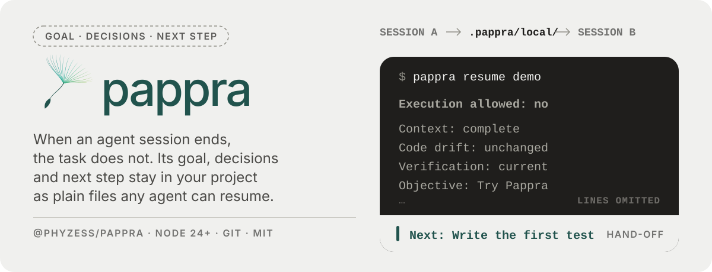
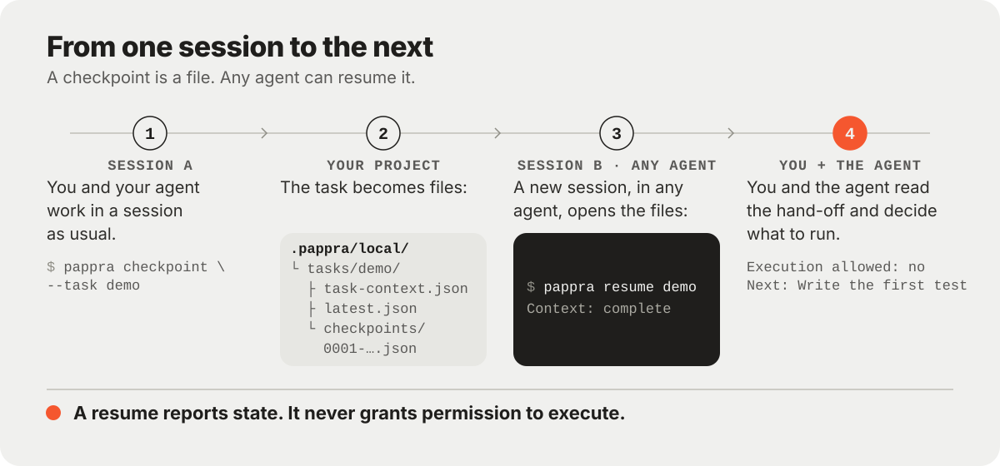

<p align="center">
  <strong>English</strong> · <a href="https://github.com/phyzess/pappra/blob/main/README.zh-CN.md">简体中文</a>
</p>

<p align="center">
  
</p>

**Your coding agent's session ends; the task does not. Pappra keeps the goal, the decisions and
the next step in your project as plain files, so the next session, in any agent, can pick the
work back up.**

## What is Pappra?

You already give your coding agent standing instructions in `CLAUDE.md` or `AGENTS.md`: how to
build, how to test, what style to follow. Those files say how to work, not where the work stands.
That lives in the conversation, so when a session gets too long, you switch tools, or you come
back tomorrow, the new session starts from nothing.

Pappra keeps the state of the task in progress — the objective, the decisions, what was tried,
what is blocked, what to do next — as files in your project folder. Any agent you choose can read
them, and none of it is lost with the chat.

- **Pick up a task in any agent.** A checkpoint saved by one session can be read by the next one,
  whichever agent it runs in.
- **Project knowledge.** Register the documents an agent should read, so the next session finds
  them instead of asking you to paste them again.
- **Code navigation.** Look up code without handing over the whole repository. Text and structure
  search work with no extra tools installed.
- **Coordinate several agents.** Split one task between agents with a visible, recorded workflow, and
  hand a running coordinator role to a fresh Claude Code or Codex session without losing the thread.
- **Connect your agents.** Claude Code, Codex and Pi can read checkpoints through Pappra's skill and
  hook, and the skill saves one when you ask.

Use only the parts you need.

Pappra's dandelion-seed identity expresses a broader direction: bring reusable working
capabilities into a workspace, grow project knowledge, and carry work across agents and
environments. Workspace adoption and knowledge growth are as important as collaborative
execution and delivery. The [product roadmap](https://github.com/phyzess/pappra/blob/main/docs/roadmap.md) separates current capabilities,
accepted foundations and the next work packages; planned outcomes are not claims of support.

## See it

A checkpoint is a saved note about one task: what it is, how you know it is done, where it stopped. A
new session runs `pappra resume demo` and gets the state of the task, not the old transcript:

```text
Task: demo
Checkpoint: checkpoints/0001-d523d72a-4553-4579-883d-93409c9df53e.json@1
Execution allowed: no
Context: complete
Code drift: unchanged
Verification: current
Objective: Try Pappra
Blocked: live_writer_unverified: A stored checkpoint cannot prove which session is still writing or has stopped; execution remains blocked.
Blocked: unknown_writer: Checkpoint author session is unknown; execution is blocked.
Next: Write the first test
```

The new session gets the objective, the reasons it cannot start on its own, and the next step, so it
can continue without the old chat. `Execution allowed: no` is intentional: a resume hands over
context, never permission; you and the agent decide what runs. The command exits `0`, and may print
read-only diagnostics on stderr.

## Quick start

You need [Node.js](https://nodejs.org/) 24 or later. The practice run below uses Git
to demonstrate repository verification on resume.

**1. Set Pappra up in a practice folder.** The empty commit gives the demo a Git revision
to verify. Run Pappra with no arguments in a terminal to select the workspace name,
repositories and document sources. The wizard previews the plan and applies it after
confirmation. It then offers optional code indexing, knowledge registration, host
integration and a health check.

```sh
mkdir pappra-demo && cd pappra-demo
git init
git -c user.name="Pappra demo" -c user.email="demo@example.invalid" commit --allow-empty -m init
npx @phyzess/pappra@beta
```

You now have a `.pappra/` folder. `.pappra/workspace.json` is shared and meant to be committed;
`.pappra/local/` is private, ignores itself, and never lands in Git. If you use Pappra every day,
install it once so the steps below can say `pappra`: `npm install -g @phyzess/pappra@beta`.

<details>
<summary>Scripts and CI</summary>

`init --yes` derives choices and previews the plan without prompting. Add `--apply` to write it.

```sh
npx @phyzess/pappra@beta init --yes
npx @phyzess/pappra@beta init --yes --apply
npx @phyzess/pappra@beta doctor
```

</details>

**2. Connect your agent (optional).** Host installation adds the Pappra skill and
lifecycle hook. Use `--host claude` or `--host pi` for project wiring, or
`--host codex --scope user` for Codex. On a terminal, review the plan and confirm it.
Approve any native trust prompt inside the host. MCP registration is a separate step.
The MCP server starts read-only by default, and writes require trusted startup policy.

```sh
npx @phyzess/pappra@beta host install --host claude
```

**3. Save a task, then resume it.** Ask a connected agent to save a checkpoint when you
stop for the day, or run the two commands yourself in the practice folder.

```sh
npx @phyzess/pappra@beta checkpoint --task demo --objective 'Try Pappra' \
  --acceptance 'A new session can pick it up' --next-action 'Write the first test'
npx @phyzess/pappra@beta resume demo
```

The first command writes one checkpoint under `.pappra/local/tasks/demo/checkpoints/`. The second
prints what a new session sees, as in the output above.

## How it works

<p align="center">
  
</p>

You and your agent work in a session as usual. When you stop, ask the agent to save a checkpoint into
`.pappra/local/`, the private part of your project folder: the objective, the decisions, what was
tried, what is blocked and the next step. A new session, in any agent, reads that file with
`pappra resume`, or receives it from Pappra's hook when the task is pinned with
`pappra task pin <id> --auto-resume`. Nothing runs on its own: you and the agent read the hand-off
and decide what to run.

## Where to go next

| I want to…                                   | Read                                                                                                            |
| -------------------------------------------- | --------------------------------------------------------------------------------------------------------------- |
| Set up and maintain a workspace              | [Operations](https://github.com/phyzess/pappra/blob/main/docs/operations.md)                                    |
| Connect Claude Code, Codex or Pi, with hooks | [Quick start](https://github.com/phyzess/pappra/blob/main/docs/quickstart.md)                                   |
| Use Pappra from an agent over MCP            | [Agent-native usage](https://github.com/phyzess/pappra/blob/main/docs/agent-native.md)                          |
| Adopt an existing multi-repository workspace | [Quick start](https://github.com/phyzess/pappra/blob/main/docs/quickstart.md)                                   |
| Register and review project knowledge        | [Knowledge workflow](https://github.com/phyzess/pappra/blob/main/skills/pappra/references/knowledge-loop.md)    |
| Read a checkpoint before taking over a task  | [Handoff and review](https://github.com/phyzess/pappra/blob/main/docs/handoff-and-review.md)                    |
| Move the workspace to another machine        | [Portability](https://github.com/phyzess/pappra/blob/main/docs/portability.md)                                  |
| Coordinate several agents on one task        | [Collaboration workflow](https://github.com/phyzess/pappra/blob/main/docs/collaboration-workflow.md)            |
| Hand a coordinator to a new session          | [Coordinator continuity](https://github.com/phyzess/pappra/blob/main/docs/cross-host-coordinator-continuity.md) |
| Start a managed Pi session that Pappra owns  | [Managed Pi sessions](https://github.com/phyzess/pappra/blob/main/docs/managed-pi.md)                           |
| Check supported versions and limits          | [Support and limitations](https://github.com/phyzess/pappra/blob/main/docs/support.md)                          |
| Build against the API                        | [API boundaries](https://github.com/phyzess/pappra/blob/main/docs/api.md)                                       |
| Work on Pappra itself                        | [Development](https://github.com/phyzess/pappra/blob/main/docs/development.md)                                  |

## FAQ

**When can Pappra start an agent?** Workspace setup, lifecycle hooks and manual
`resume` are independent of model execution. An explicit `session start` can launch
managed Pi, and `collab run --controller pi-rpc` can launch an admitted Pi RPC run.
Those commands use the selected host runtime and its model configuration.

**Does Pappra approve my agent's trust prompts?** No. Connecting an agent adds Pappra's skill and
hook, and the first-run approval inside Claude Code, Codex or Pi is yours to give.

**How is this different from `CLAUDE.md` or agent memory?** Those files hold standing instructions
and apply across sessions. A checkpoint records where one task stands, including decisions
and the next step. You or your agent save it with `pappra checkpoint`. Hooks record
lifecycle observations and can surface the selected task's saved context on startup.

**What gets committed, and what stays on my machine?** Commit the shared
`.pappra/workspace.json` and any intentionally shared knowledge records and documents.
The ignored `.pappra/local/` holds checkpoints and machine settings. The durable Pappra
runtime lives in your user data folder, outside the `npx` cache.

**Do I need a code graph, or an agent, to try it?** No. Node.js and Git are enough: checkpoints and
resumes work without an agent, and code queries fall back to text without a graph engine.

**Why does resume say execution is not allowed?** Because handing over context is not the same as
permission to run. `Execution allowed: no` is the normal answer; you and the agent decide what
happens next.

## Status

Pappra is published as `@phyzess/pappra`. The `beta` dist-tag tracks beta releases.
Use an exact version for reproducible installs. These docs describe the main branch,
which can contain changes beyond the current npm release. See
[support and limitations](https://github.com/phyzess/pappra/blob/main/docs/support.md) for the tested host versions and evidence.

## License

Pappra is licensed under the MIT License. See [LICENSE](https://github.com/phyzess/pappra/blob/main/LICENSE) and
[THIRD_PARTY_NOTICES.md](https://github.com/phyzess/pappra/blob/main/THIRD_PARTY_NOTICES.md).
