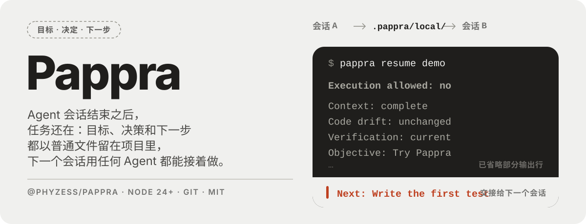
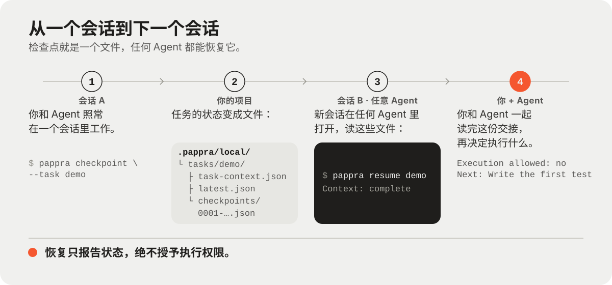

<p align="center">
  <a href="README.md">English</a> · <strong>简体中文</strong>
</p>

<p align="center">
  
</p>

Pappra 把编码 Agent 继续一项任务所需的东西——工作区配置、选定的项目知识、检查点、恢复上下文，
以及有界的代码导航——保存在工作区自己拥有的文件里，而不是某一段聊天记录中。你选择启用的宿主
读写的是同一份状态。

Pappra 是管理者。外部的编码宿主、代码图引擎和协作控制器都是可选集成，不是安装前提。

## 你能得到什么

- **工作区配置：** `.pappra/workspace.json`，以及检出目录本地的 `.pappra/local/machine.json`。
- **知识：** 工作区文档清单和私有文档清单，带有显式的预览与应用步骤；共享清单按文件逐条提交
  记录，因此并行登记不会在单一的聚合时间戳上发生冲突。
- **连续性：** 私有检查点和有界的建议性恢复包。恢复本身从不授予执行权限；`executionAllowed:false`
  并附带阻塞原因，是一个正常的、成功的结果。
- **代码智能：** 针对选定仓库的状态、显式准备和有界查询。没有代码图引擎时，文本与结构回退仍可使用。
- **集成（均为可选）：** 宿主钩子、基于 MCP 的 Agent 工具，以及 Agent 之间的有界协作。

## 工作原理

<p align="center">
  
</p>

宿主通过钩子、MCP 服务或命令行与 Pappra 交互。Pappra 读写两处位置：`.pappra/workspace.json`，
它是共享并提交的；以及 `.pappra/local/`，它是私有的，并且会自动忽略自身。代码引擎的登记信息保存在
`.pappra/local/code` 下，绝不放进检出目录里。

## 快速开始

环境要求：Node.js 24 或更高版本。只有在本仓库内开发时才需要 `pnpm` 12.3.4；只有命令需要观察仓库
身份时才需要 Git。

软件包以 `@phyzess/pappra` 发布。日常使用可以全局安装一次（`npm install -g @phyzess/pappra@beta`，
命令是 `pappra`），想要零安装、固定版本的调用时则用 `npx`。

```sh
# 在一个空的目标工作区中（不是本仓库的检出目录）
mkdir -p <empty-dir> && cd <empty-dir>
curl -fsSL https://raw.githubusercontent.com/phyzess/pappra/main/examples/minimal-choices.json -o ./minimal-choices.json

# 先预览。JSON/配置模式是非交互式的，不会提示。
npx @phyzess/pappra@beta init --config ./minimal-choices.json --json

# 应用同样的选择。应用时还会安装并绑定一份持久的运行时副本，
# 因此会以退出码 0 收敛；加上 --no-runtime 可以把这部分工作留到以后。
npx @phyzess/pappra@beta init --config ./minimal-choices.json --apply --json
npx @phyzess/pappra@beta doctor --json
```

`examples/minimal-choices.json` 对于无宿主、无代码图、单目录的工作区是完整的。如果想要非交互式的
自动推导，可以运行 `npx @phyzess/pappra@beta init --yes --apply --json`，它会从发现结果中推导仓库、
知识来源、代码引擎、校验命令、排除项和宿主。`--print-choices` 会打印推导出的选择，并且不写入任何内容。

从检出目录开发的方式相同：`pnpm install --frozen-lockfile`、`pnpm build`，然后在目标工作区里用
绝对路径调用 `dist/cli/main.js`。

`init` 如何规划与应用、运行时副本如何管理、如何修复被中断的状态，见[运维参考](docs/operations.md)
（英文）。

## 试一试检查点与恢复

目标目录成为 Git 工作树之后，创建一个建议性检查点并读回它。本页顶部的输出就是最后一条命令的摘录。

```sh
npx @phyzess/pappra@beta checkpoint --task demo --objective 'Try Pappra' \
  --acceptance 'Resume stays advisory' \
  --author-session demo --native-session demo \
  --context-completeness complete --json
npx @phyzess/pappra@beta resume demo --session demo
```

恢复包是建议性的。请检查 `executionAllowed`：能读到检查点并不意味着获准开始工作，而
`executionAllowed:false` 并附带阻塞原因，是一个成功的建议性结果（退出码 `0`）。验证已过期时，
命令才会以非零状态退出。

## 集成

这里的一切都是可选的，并且有各自的前提条件，而不是自动生成的文件；核心工作流不需要其中任何一项。

- **宿主集成：** `pappra host install` 会合并 Pappra 自己拥有的钩子条目，而不会接管用户的配置。
  钩子以无依赖的包形式提供；Claude Code 使用 `${CLAUDE_PROJECT_DIR}`，Pi 以相对路径导入其运行时，
  Codex 则以用户级方式接入（`--scope user`）。`host bundle --marketplace` 会导出注册材料，但不会
  注册或信任任何东西。见[宿主插件验证](docs/host-plugin-validation.md)（英文）。
- **面向 Agent 的原生工具：** `pappra mcp` 通过 stdio 提供有界的工具；写入类工具需要受信任的服务器
  启动策略，而不是 Agent 自己提供的标志。`pappra host mcp install` 会把它注册给 Claude Code 或 Pi；
  Codex 使用 `codex mcp add`。`pappra task pin <id> --auto-resume` 让钩子注入一个有界的恢复包。
  见[Agent 原生用法](docs/agent-native.md)（英文）。
- **受管的原生会话：** `pappra session plan|start|status|fence|stop --config <absolute-file>`
  会启动一个由控制器拥有的、可见的 Pi TUI。PTY 模式会把队列、审批和进行中事项的清单报告为未知，
  并且 `transferReady: false`；可选启用的 SDK 模式固定使用 Pi 1.4.0，并且只证明其所拥有的运行时
  已被释放。见[受管的 Pi 会话](docs/managed-pi-session.md)（英文）。
- **协作：** `pappra collab workflow prepare|dispatch|ack|report|accept|release` 为一个已声明的
  协作组编排现有协议。角色不授予任何权限，报告不等于验收，通知也不等于执行。见
  [工作流契约](docs/collaboration-workflow.md)和
  [有界协作](skills/pappra/references/collaboration.md)（均为英文）。

| 能力                                    | 前提                                     | 默认状态                       |
| --------------------------------------- | ---------------------------------------- | ------------------------------ |
| 工作区、init、doctor、检查点/恢复、知识 | 只需 Node.js；仓库身份需要 Git           | 核心                           |
| 代码图的状态/准备/查询                  | 可选的外部代码图引擎                     | 除非选用否则禁用；保留文本回退 |
| 宿主钩子                                | 显式选定的 Pi、Codex 或 Claude Code 集成 | 不会自动安装                   |
| 协作控制器                              | 显式的 `--controller <fixture\|pi-rpc>`  | 没有隐式控制器                 |

宿主名称和协议标识符描述的是受支持的集成面。它们并不会让任何宿主、模型、代码图引擎或私有工作区
成为核心用法的前提。

## 文档

以下文档目前只有英文版。

- [快速开始](docs/quickstart.md)和[运维参考](docs/operations.md)
- [API 边界](docs/api.md)和[Agent 原生用法](docs/agent-native.md)
- [支持范围与限制](docs/support.md)、[可移植性](docs/portability.md)和
  [分发](docs/distribution-plan.md)
- [开发](docs/development.md)，其中也涵盖 `pnpm check`

## 状态与限制

Pappra 是开发阶段的软件（`0.1.0-beta.22`）。软件包是 `@phyzess/pappra`，使用 `beta` dist-tag。
版本通过 GitHub Actions 以 npm 可信发布（OIDC）的方式发布；这里不保存任何 npm 令牌。请固定到
移动的 `beta` 标签，或者固定到某个确切版本，因为预发布版本绝不会被重新发布。

确定性测试套件覆盖的是合成的工作区、测试夹具和本地进程边界。它并不能证明真实模型的行为、
各平台上原生宿主的可调用性、代码图引擎的完整性、Windows/Linux 的一致性，或生产环境的性能。
宿主版本的固定是一种“观察到的支持声明”，并不证明某个具体安装一定能加载或运行。

评审状态，包括每一条被跟踪的发现及其当前状态，见[评审收尾](docs/review-closeout.md)（英文）。冷启动用例
实际展示了什么，见[冷启动验收](docs/cold-start-acceptance.md)（英文）。

## 许可证

Pappra 采用 MIT 许可证。见 [LICENSE](LICENSE) 和 [THIRD_PARTY_NOTICES.md](THIRD_PARTY_NOTICES.md)。
