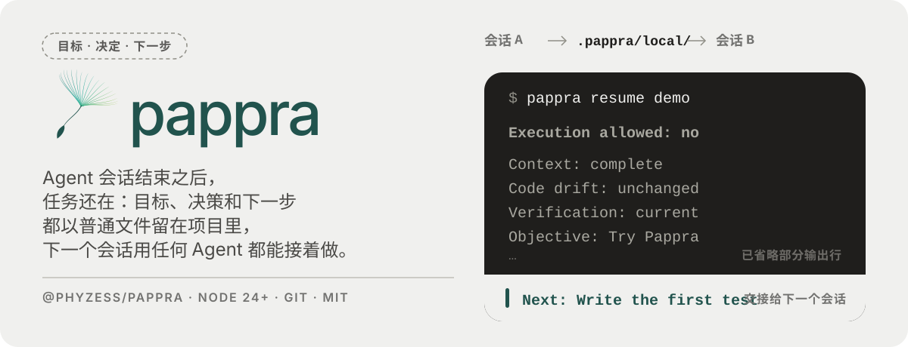
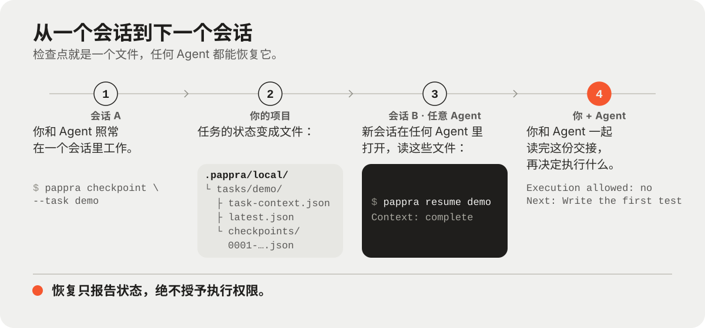

<p align="center">
  <a href="https://github.com/phyzess/pappra/blob/main/README.md">English</a> · <strong>简体中文</strong>
</p>

<p align="center">
  
</p>

**编码 Agent 的会话会结束，任务不会。Pappra 把目标、已经做过的决定和下一步保存成你项目里的
普通文件，下一个会话——不论用哪个 Agent——都能接着把这件事做下去。**

## 什么是 Pappra？

你已经在 `CLAUDE.md` 或 `AGENTS.md` 里给编码 Agent 写下了长期指令：怎么构建、怎么测试、遵循什么
风格。这些文件说明的是“怎么干活”，而不是“活干到哪一步了”。后者只存在于对话里，所以当会话太长、
你换了工具、或者隔天再回来的时候，新的会话只能从零开始。

Pappra 把当前任务的状态——目标、已经做过的决定、试过什么、卡在哪里、下一步做什么——保存成你项目
文件夹里的文件。你选用的任何 Agent 都能读到它们，这些信息也不会随聊天记录一起消失。

- **在任何 Agent 里接着做。** 一个会话保存的检查点，下一个会话都能读，不论它跑在哪个 Agent 里。
- **项目知识。** 把 Agent 该读的文档登记进来，下一次会话能自己找到，不必让你再贴一遍。
- **代码导航。** 查找代码时不必把整个仓库都交给 Agent。即使不安装额外工具，文本与结构搜索也能用。
- **协调多个 Agent。** 用可见、可追溯的工作流把一项任务拆给多个 Agent，并能把进行中的协调者角色交接给新的
  Claude Code 或 Codex 会话，而不丢失进度。
- **接入你的 Agent。** 通过 Pappra 的技能和钩子，Claude Code、Codex 和 Pi 可以读取检查点，而保存检查点
  是在你要求时才由技能执行。

按需取用即可。

Pappra 的蒲公英种子意象承载着更完整的方向：把可复用的工作能力带进 workspace，积累项目知识，
并让工作跨 Agent、会话与环境延续。项目接入与知识生长，和协作执行与交付同样重要。
[产品路线图](https://github.com/phyzess/pappra/blob/main/docs/roadmap.md) 区分当前能力、已验收的基础与下一阶段工作包；规划目标不代表已经支持。

## 看看效果

检查点是关于一项任务的备忘文件：任务是什么、怎样算完成、停在了哪里。新会话运行
`pappra resume demo`，拿到的是任务状态，而不是旧的对话记录：

```text
Task: demo
Checkpoint: checkpoints/0001-d523d72a-4553-4579-883d-93409c9df53e.json@1
Execution allowed: no
Context: complete
Code drift: unchanged
Verification: current
Objective: Try Pappra
Blocked: live_writer_unverified: A stored checkpoint cannot prove which session is still writing or has stopped; execution remains blocked.
Blocked: unknown_writer: Checkpoint author session is unknown; execution is blocked.
Next: Write the first test
```

新会话由此得到目标、无法自行开工的原因，以及下一步，因此不必翻旧聊天就能继续。
`Execution allowed: no` 是有意为之：恢复只交接上下文，从不授予权限。具体跑什么由你和 Agent 决定。
命令的退出码是 `0`，还可能把只读诊断信息打印到 stderr。

## 快速开始

你需要 [Node.js](https://nodejs.org/) 24 或更高版本。下面的练习使用 Git 演示恢复时的仓库验证，
可以独立于 Agent 和模型服务运行。

**1. 在练习文件夹里配置 Pappra。** 空提交为演示提供一个可验证的 Git 修订。在终端中不带参数运行
Pappra，即可选择工作区名称、仓库和文档来源。向导先预览计划，确认后应用，再依次提供可选的代码索引、
知识登记、宿主接入和健康检查。

```sh
mkdir pappra-demo && cd pappra-demo
git init
git -c user.name="Pappra demo" -c user.email="demo@example.invalid" commit --allow-empty -m init
npx @phyzess/pappra@beta
```

现在你有了一个 `.pappra/` 目录。`.pappra/workspace.json` 是共享的，应当提交到 Git；
`.pappra/local/` 是私有的，会自动忽略自身，永远不会进入 Git。如果你每天都用 Pappra，就安装一次，
这样下面的步骤就能直接写 `pappra`：`npm install -g @phyzess/pappra@beta`。

<details>
<summary>脚本与 CI</summary>

`init --yes` 自动推导选择并预览计划。加上 `--apply` 才会写入。

```sh
npx @phyzess/pappra@beta init --yes
npx @phyzess/pappra@beta init --yes --apply
npx @phyzess/pappra@beta doctor
```

</details>

**2. 接入你的 Agent（可选）。** 安装时会加入 Pappra 技能和生命周期钩子。Claude Code 和 Pi 的
项目接入分别用 `--host claude`、`--host pi`，Codex 用 `--host codex --scope user`。
在终端中查看计划并确认，宿主的信任提示在宿主内批准。MCP 可单独登记，默认以只读模式启动，
写操作需要受信任的启动策略。

```sh
npx @phyzess/pappra@beta host install --host claude
```

**3. 保存任务检查点，再恢复它。** 收工时可请已接入的 Agent 保存检查点，也可以在练习文件夹中
自己运行下面两条命令。

```sh
npx @phyzess/pappra@beta checkpoint --task demo --objective 'Try Pappra' \
  --acceptance 'A new session can pick it up' --next-action 'Write the first test'
npx @phyzess/pappra@beta resume demo
```

第一条命令会在 `.pappra/local/tasks/demo/checkpoints/` 下写入一个检查点。第二条命令打印新会话看到的
内容，也就是上面那段输出。

## 工作原理

<p align="center">
  
</p>

你和 Agent 像平常一样在一个会话里工作。当你收工时，让 Agent 把检查点写入 `.pappra/local/`，也就是
项目文件夹中私有的那部分：目标、已经做过的决定、试过什么、卡在哪里、下一步做什么。新的会话不论是哪个
Agent，都用 `pappra resume` 读这个文件，或者在任务用 `pappra task pin <id> --auto-resume` 固定之后，
由 Pappra 的钩子把它送达。没有任何东西会自动开始：你和 Agent 一起读这份交接，然后决定要运行什么。

## 接下来看什么

| 我想要…                                 | 看这篇                                                                                                |
| --------------------------------------- | ----------------------------------------------------------------------------------------------------- |
| 配置与维护工作区                        | [运维参考](https://github.com/phyzess/pappra/blob/main/docs/operations.md)                            |
| 接入 Claude Code、Codex 或 Pi（含钩子） | [快速开始](https://github.com/phyzess/pappra/blob/main/docs/quickstart.zh-CN.md)                      |
| 让 Agent 通过 MCP 使用 Pappra           | [Agent 原生用法](https://github.com/phyzess/pappra/blob/main/docs/agent-native.md)                    |
| 接管已有的多仓库工作区                  | [快速开始](https://github.com/phyzess/pappra/blob/main/docs/quickstart.zh-CN.md)                      |
| 登记和审查项目知识                      | [知识工作流](https://github.com/phyzess/pappra/blob/main/skills/pappra/references/knowledge-loop.md)  |
| 接手任务前读取检查点                    | [交接与审查](https://github.com/phyzess/pappra/blob/main/docs/handoff-and-review.md)                  |
| 把工作区搬到另一台机器                  | [可移植性](https://github.com/phyzess/pappra/blob/main/docs/portability.md)                           |
| 协调多个 Agent 完成同一项任务           | [协作工作流](https://github.com/phyzess/pappra/blob/main/docs/collaboration-workflow.md)              |
| 把协调者交接给新的会话                  | [协调者连续性](https://github.com/phyzess/pappra/blob/main/docs/cross-host-coordinator-continuity.md) |
| 启动由 Pappra 拥有的受管 Pi 会话        | [受管的 Pi 会话](https://github.com/phyzess/pappra/blob/main/docs/managed-pi.md)                      |
| 查看支持的版本与限制                    | [支持范围与限制](https://github.com/phyzess/pappra/blob/main/docs/support.md)                         |
| 基于 API 开发                           | [API 边界](https://github.com/phyzess/pappra/blob/main/docs/api.md)                                   |
| 参与 Pappra 本身的开发                  | [开发](https://github.com/phyzess/pappra/blob/main/docs/development.md)                               |

## 常见问题

**Pappra 什么时候会启动 Agent？** 工作区配置、生命周期钩子和手动 `resume` 独立于模型执行。
显式运行 `session start` 可以启动受管 Pi，`collab run --controller pi-rpc` 可以启动已通过准入
检查的 Pi RPC 运行。这些命令使用选定的宿主运行时及其模型配置。

**Pappra 会替我确认 Agent 的信任提示吗？** 不会。接入 Agent 只是加上 Pappra 的技能和钩子，
Claude Code、Codex 或 Pi 里的首次确认由你完成。

**它和 `CLAUDE.md` 或 Agent 记忆有什么区别？** 那些文件保存的是长期指令，每次会话读到的内容都一样。
检查点记录一项任务的当前状态，包括已做的决定和下一步。你或 Agent 可以运行 `pappra checkpoint`
保存它。钩子会记录生命周期事件，并可在启动时提供已选任务的上下文。

**哪些内容会提交，哪些只留在这台机器上？** 提交共享的 `.pappra/workspace.json`，以及明确共享的
知识记录和文档。被 Git 忽略的 `.pappra/local/` 保存检查点和本机设置。持久运行时保存在用户数据
目录中，独立于 `npx` 缓存。

**试用它需要代码图或者 Agent 吗？** 不需要。有 Node.js 和 Git 就够了；没有 Agent 也能保存和恢复
检查点，没有配置代码图引擎时，代码导航会回退到文本搜索。

**为什么恢复结果里的“允许执行”是 no？** 因为交接上下文不等于授权执行。`Execution allowed: no` 是正常
结果；接下来做什么，由你和 Agent 决定。

## 状态

Pappra 以 `@phyzess/pappra` 发布，`beta` 标签跟踪 beta 版本。需要复现安装时，请指定确切版本。
本文档对应 main 分支，其中可能包含当前 npm 发布版之后的改动。测试覆盖的宿主版本和证据范围见
[支持范围与限制](https://github.com/phyzess/pappra/blob/main/docs/support.md)。

## 许可证

Pappra 采用 MIT 许可证。见 [LICENSE](https://github.com/phyzess/pappra/blob/main/LICENSE) 和 [THIRD_PARTY_NOTICES.md](https://github.com/phyzess/pappra/blob/main/THIRD_PARTY_NOTICES.md)。
